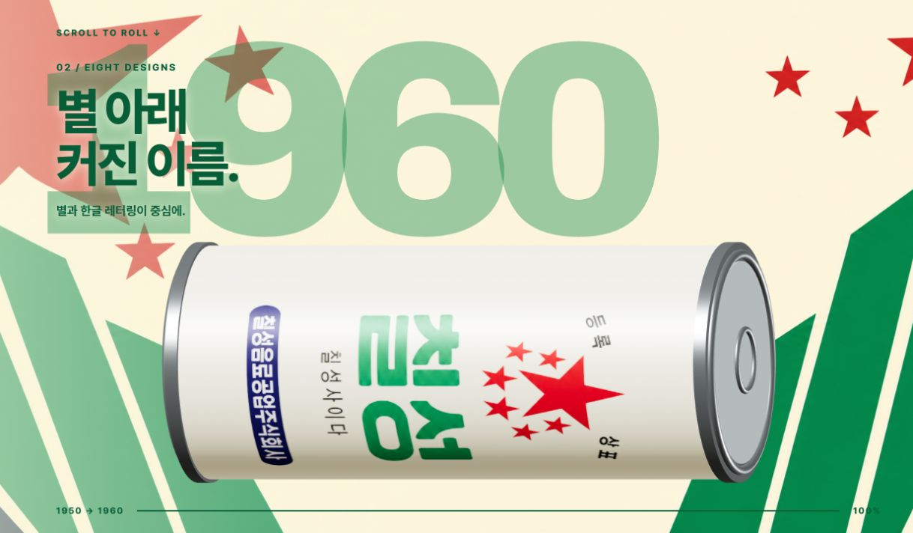

# CHILSUNG CIDER — Web 3D and Blender rolling can

## 웹사이트: 1950 → 1960 스크롤 3D 프로토타입

정적 브랜드 사이트의 History 첫 두 구간에 Three.js 캔과 GSAP ScrollTrigger를 연결했습니다. 가로로 누운 캔은 스크롤을 따라 아래로 이동하며 긴 축으로 회전하고, 원통 표면의 1950·1960 패키징이 자연스럽게 혼합됩니다. 아래로 내리다 멈추면 캔도 멈추며, 위로 올리면 역방향으로 재생됩니다.

1. Node.js가 설치된 컴퓨터에서 이 저장소를 다운로드하거나 클론합니다.
2. 프로젝트 폴더에서 `node experiments/serve-local.mjs`를 실행합니다.
3. `http://127.0.0.1:8767/index.html#history-3d`에서 통합된 사이트를 확인합니다. `http://127.0.0.1:8767/experiments/history-3d-1950-1960.html`은 독립 확인 페이지입니다.

서버 실행에는 추가 패키지 설치가 필요하지 않습니다. 로컬 Three.js와 GSAP 파일이 `js/vendor/`에 포함되어 있습니다. HTML을 파일로 직접 열면 ES 모듈이 실행되지 않을 수 있으므로 로컬 서버 주소로 접속하세요.

구조와 연도 추가 방법: [docs/history-3d-prototype.md](./docs/history-3d-prototype.md). 1950·1960 패키징 PNG는 사용자가 제공한 `칠성.zip`에서 추출했으며, 원본 ZIP과 아래 Blender 스크립트는 변경하지 않았습니다.



---

## Blender 실험

## v3 — 실제 칠성사이다 패키징 1950 ↔ 1960 (2026-10-26)

[rolling_can_v3.py](./rolling_can_v3.py)를 추가했습니다. 첨부 ZIP 안에서 아래 평면 라벨 2개를 자동으로 찾아 캔에 적용하는 **새로운** 테스트 스크립트입니다.

- `칠성/img/1950packaging.png` — 아이보리 바탕 + 빨간 별/CIDER
- `칠성/img/1960packaging.png` — 아이보리 바탕 + 초록 칠성 로고

4초 동안 같은 위치에서 캔이 계속 회전하고, 1950 → 1960 → 1950 패키징이 자연스럽게 바뀝니다. 배경 이미지들은 캔 텍스처가 아니므로 아직 사용하지 않습니다. 이후 스크롤 웹 페이지에서 배경과 디자인을 연결할 예정입니다.

### 실행 방법 (처음 하는 사용자)

1. 기존 `rolling_can_v02.blend` 파일은 안전하게 보관하세요.
2. 컴퓨터의 **같은 폴더에** `칠성.zip`을 둡니다. 압축을 풀 필요는 없습니다.
3. Blender에서 **File → New → General**을 선택합니다.
4. Blender **File → Save As...**로 **그 ZIP 파일과 같은 폴더에** `rolling_can_v03.blend`를 먼저 저장합니다.
5. GitHub [rolling_can_v3.py](./rolling_can_v3.py) 페이지에서 **Raw**를 열고 코드를 전부 복사합니다.
6. Blender의 **Scripting → New**에 붙여넣고 **Alt+P**를 누릅니다.
7. **Layout** 탭으로 돌아가 오른쪽 위의 **Material Preview**를 선택하고 **Space**로 재생합니다.
8. 실제 디자인이 보이면 **Ctrl+S**로 저장합니다.

**주의:** 스크립트를 실행하면 **현재 씬에 있는 모든 오브젝트를 삭제**합니다. 반드시 빈 새 파일에서 실행하세요. ZIP이 없거나 해당 파일을 못 찾으면 빨간색/초록색 임시 색상으로 표시됩니다. 해당 경우 ZIP 경로·파일명을 확인하세요.

**검증 상태:** GitHub 코드 등록까지 완료. 이 환경에는 Blender 프로그램이 없으므로 실제 렌더 검증은 진행하지 못했습니다. 캔에 감긴 로고의 크기나 방향은 Blender에서 보고 조정할 수 있습니다.

---


**A fixed-camera, horizontally lying beverage can that rotates in place while its package design smoothly changes A → B → C → A.**

## What's in this repository

- [rolling_can.py](./rolling_can.py): **v1** — the first working can + continuous rotation. Kept unchanged as a backup.
- [rolling_can_v2.py](./rolling_can_v2.py): **v2** — same can movement + **three smoothly crossfading packaging images** (4-second seamless animation, 30 fps, 120 frames).
- `rolling_can_v01.blend` or `rolling_can_v02.blend`: **not uploaded yet**. These are Blender project files you save yourself.

## Step 1 — Prepare package artwork

Download/export the three package designs as **flat label images**, rather than photos of a can seen in perspective. PNG is recommended; ideally, each has the same pixel dimensions and layout.

Rename the files exactly:
- `package_a.png`
- `package_b.png`
- `package_c.png`

Put the three PNG files in **the same local folder as the Blender .blend file**. The images that were shown in ChatGPT are *not* transferred automatically to your PC or GitHub.

If your references are screenshots or realistic can mockups, first obtain/export the underlying flat packaging design; applying a perspective image as a UV label would distort it.

## Step 2 — Start a new Blender scene

1. Open Blender → **File → New → General**.
2. **File → Save As** → save `rolling_can_v02.blend` in the folder with the three PNGs.
3. On GitHub open [rolling_can_v2.py](./rolling_can_v2.py), click **Raw**, and copy the whole code.
4. In Blender choose **Scripting → New**, paste the code and press **Alt + P**.
5. Choose **Layout** and **Camera View** (numpad 0).
6. Enable **Material Preview** mode (the sphere icon at the top right of the 3D viewport) and press **Space** to play.

**Warning:** This code deletes every object in the current Blender scene. Always run it in a fresh scene or after making a backup.

## Step 3 — Troubleshooting image files

If the can turns **pink → green → blue** instead of showing your actual package designs, the program did not find your PNGs.

Check the spelling and location of all 3 files. Alternatively, edit the first lines of `rolling_can_v2.py`:

```python
IMAGE_FOLDER = r"C:\\Users\\yourname\\Downloads"
```

Replace it with the full folder location that actually contains your files. Do not put individual image file paths in `IMAGE_FOLDER`.

If you get odd wrapping, check that your design is a **flat can label**: the image's horizontal direction maps around the can's circumference and its vertical direction maps along the can's length. Adjust or rotate the PNG artwork before importing if needed.

## Step 4 — Save the work

After confirming the preview, **File → Save As** to save `rolling_can_v02.blend`. When images are found, the script tries to **pack them into the .blend** to make the project easier to move.

To continue on another computer, you can download this GitHub repository, create a new Blender scene, and run the v2 script with the three original PNGs alongside the saved .blend.

## Animation spec

- Camera: orthographic, fixed
- Can: position and apparent size fixed, X-axis rotation
- Motion: 360 degrees / 4 seconds, constant rotation speed
- Package transitions: smooth fade from A to B (frames 1-41), B to C (41-81), C to A (81-121)
- Export: frames 1-120, so the identical end frame 121 does not create a pause.

*The Blender script was authored for Blender 4.x–5.x APIs but has not been rendered/tested in the Blender application in this environment.*
